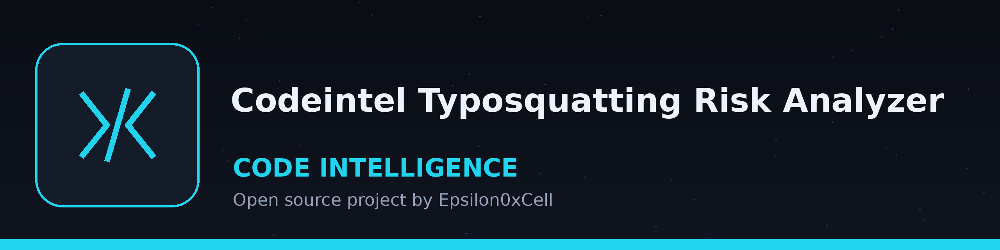

# codeintel-Typosquatting-Risk-Analyzer
Analyzes project dependencies for names that are visually similar to popular packages (e.g., 'requests' vs 'requesrs') to identify potential typosquatting risks. - Focused on Tools for static code analysis, vulnerability scanning, and code quality assurance

## Install
`git clone https://github.com/ShadowStrikeHQ/codeintel-typosquatting-risk-analyzer`

## Usage
`./codeintel-typosquatting-risk-analyzer [params]`

## Parameters
- `-h`: Show help message and exit
- `--threshold`: No description provided
- `--top-packages`: How many entries of the comparison list to use (default 20)
- `--log-level`: No description provided

## The comparison list
Dependencies are compared against a fixed list of 183 widely downloaded PyPI package names written in `main.py`. The list is fixed in the source: no package index is queried and nothing is fetched at run time, so names outside that list are never compared. `--top-packages` selects how many entries of the list to use; asking for more than 183 prints a warning and uses the whole list.

## License
Copyright (c) ShadowStrikeHQ
