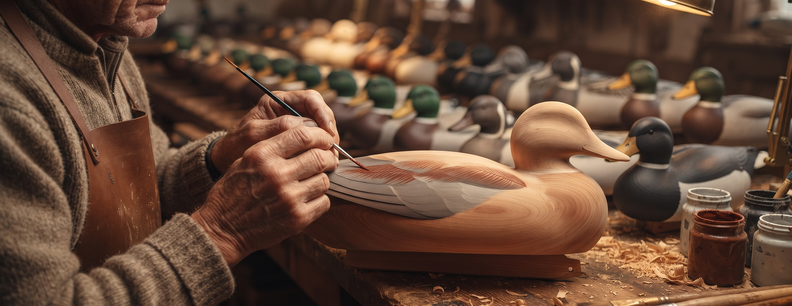
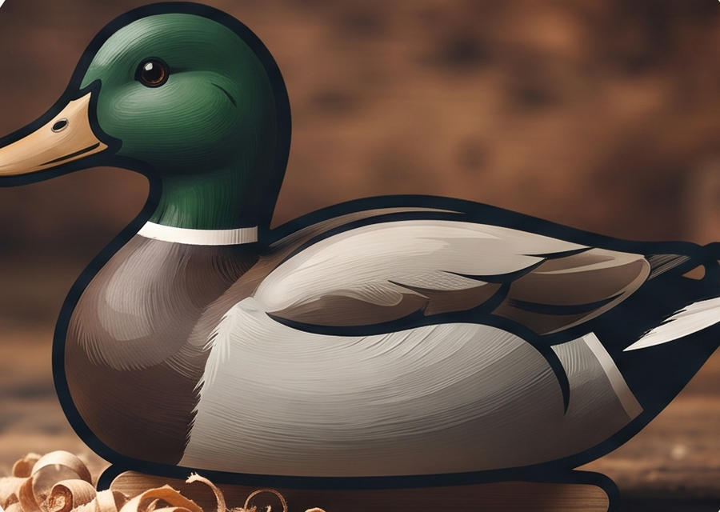

# codeintel-Typosquatting-Risk-Analyzer

Title block: the name above is set in Bevan in storm slate on chalk white, ruled beneath like an entry in the miller's day book. The wheel mark below stands beside this first heading only and is nowhere repeated as decoration.

# codeintel-Typosquatting-Risk-Analyzer

Analyzes project dependencies for names that are visually similar to popular packages (e.g., 'requests' vs 'requesrs') to identify potential typosquatting risks. - Focused on Tools for static code analysis, vulnerability scanning, and code quality assurance

## Install

> Notice chalked on the mill door: more than 183 list entries cannot be had; asking for more prints a warning and uses the whole list.

`git clone https://github.com/ShadowStrikeHQ/codeintel-typosquatting-risk-analyzer`

## Usage

> Notice chalked on the mill door: an exact match is not a risk; a name identical to a list entry, once normalised, is skipped.

`./codeintel-typosquatting-risk-analyzer [params]`

## Parameters

> Notice chalked on the mill door: a finished scan exits 0 even when risks are printed.

- `-h`: Show help message and exit

- `--threshold`: No description provided

- `--top-packages`: How many entries of the comparison list to use (default 20)

- `--log-level`: No description provided

## The comparison list

Dependencies are compared against a fixed list of 183 widely downloaded PyPI package names written in `main.py`. The list is fixed in the source: no package index is queried and nothing is fetched at run time, so names outside that list are never compared. `--top-packages` selects how many entries of the list to use; asking for more than 183 prints a warning and uses the whole list.

## License

Copyright (c) ShadowStrikeHQ

## Facts from the code, stated in the prose

This record names: requirements.txt, SequenceMatcher, difflib, 183, 0.8, first 20 entries, DEBUG, INFO, WARNING, ERROR, and CRITICAL, python3 main.py, PEP 503.
